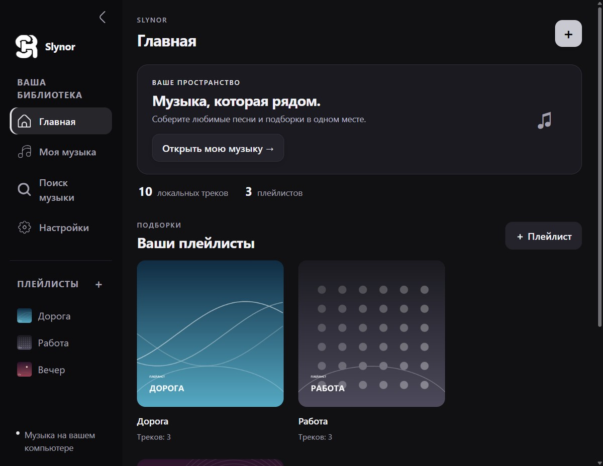
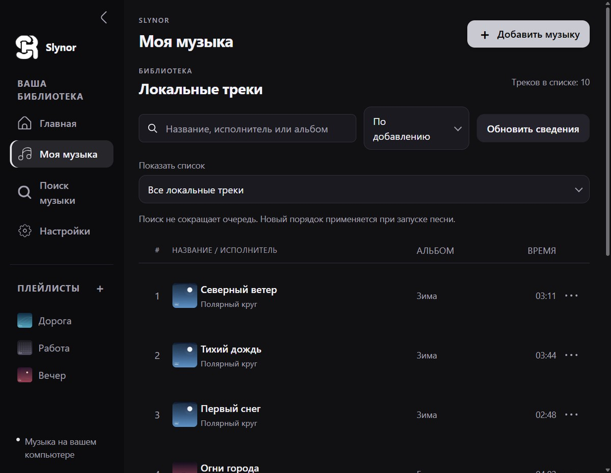
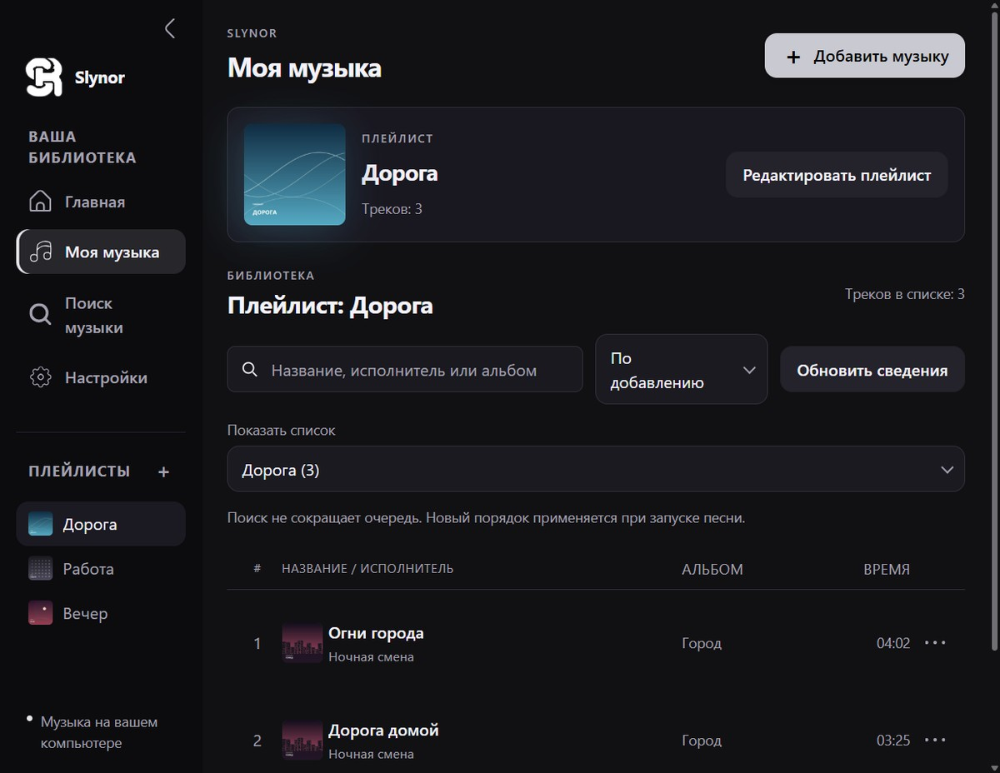
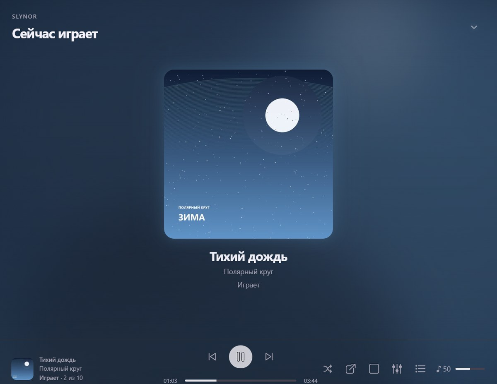
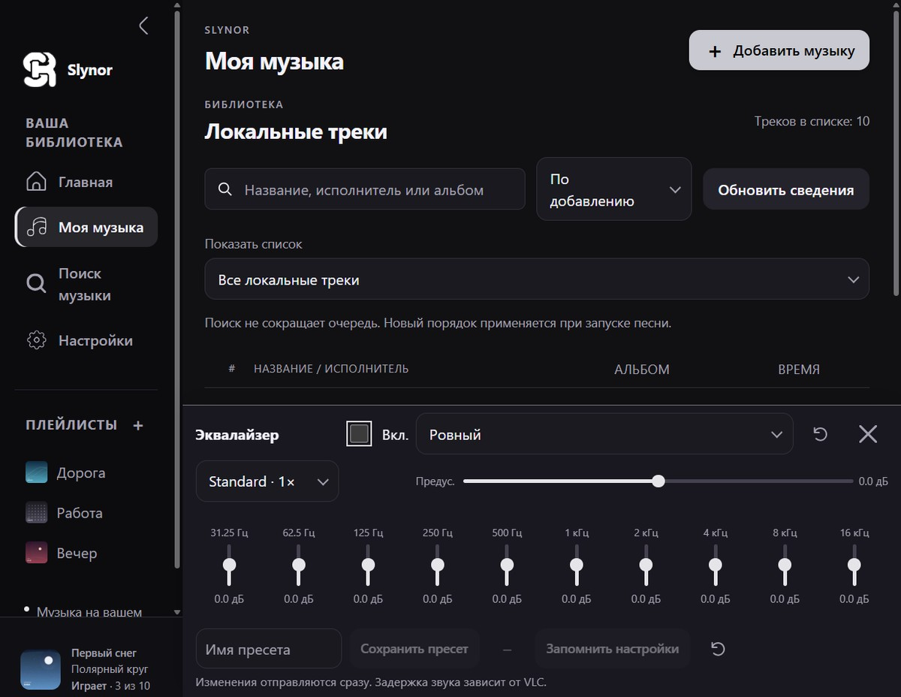
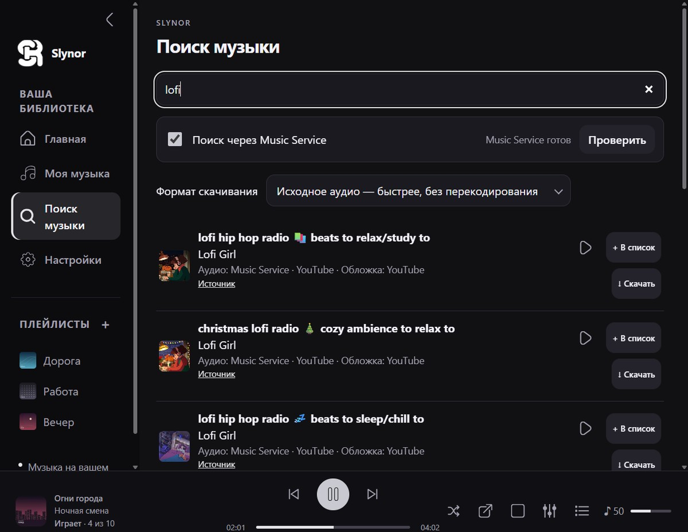
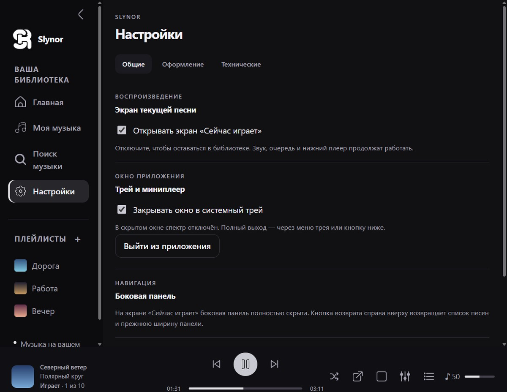
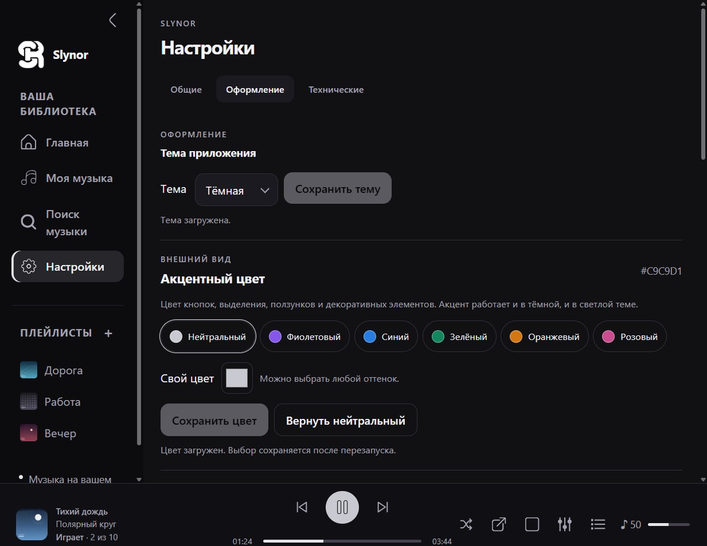
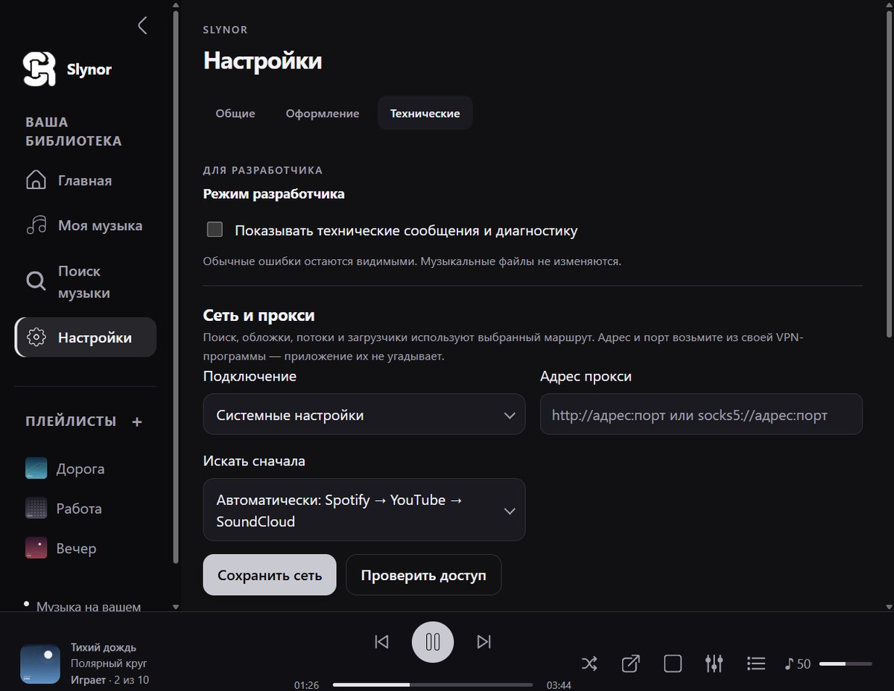

# Slynor

**Музыкальный плеер для Windows с собственной библиотекой, плейлистами и поиском в интернете.**

Slynor — локальное десктопное приложение, а не стриминговый сервис. Музыка лежит на диске:
плеер индексирует папки, читает теги и обложки, собирает плейлисты и воспроизводит файлы через
LibVLC. Отдельный слой умеет искать треки в интернете и скачивать их в локальную коллекцию.

Интерфейс — HTML/CSS/JavaScript в окне [pywebview](https://pywebview.flowrl.com/) (Edge WebView2),
логика — Python и локальный [FastAPI](https://fastapi.tiangolo.com/), доступный только на
`127.0.0.1:8765`. Наружу приложение не открывается и не требует аккаунта.


> **Статус:** личный проект в активной разработке. Стабильного релиза нет,
> приёмка на чистой Windows ещё не пройдена. Код и интерфейс меняются без предупреждения.

## Скриншоты

<p align="center">
  
</p>

<p align="center">
  
  
</p>

<p align="center">
  
  
</p>

<p align="center">
  
  
</p>

<p align="center">
  
  
</p>

<sub>Скриншоты сняты на демонстрационном профиле с синтетической библиотекой, а не на личной коллекции. Обложки и названия треков — выдуманные.</sub>

## Возможности

### Библиотека

- Индексация выбранных папок: имя, исполнитель, альбом, длительность, путь к файлу.
- Обложки, встроенные в теги, с кэшем; заглушки, если картинки нет.
- Поиск по названию, исполнителю и альбому, сортировка списка.
- Сведения о файле; удаление записи из библиотеки не трогает сам файл.
- Отдельно — онлайн-каталог: результаты поиска и уже скачанные треки в одном списке.

### Плейлисты

- Создание плейлистов, редактирование состава, собственные обложки.
- Панель «Добавить в плейлисты» и выбор плейлиста, в который добавляются песни по умолчанию.
- Очередь воспроизведения — снимок списка: её можно открыть и посмотреть состав.

### Воспроизведение

- LibVLC под капотом: те же контейнеры и кодеки, что поддерживает VLC.
- Очередь, следующий/предыдущий трек, перемешивание, громкость, перемотка.
- Нижняя панель плеера, отдельный экран «Сейчас играет», компактный мини-плеер.
- Скорость воспроизведения: 0.8×, 1×, 1.25×.

### Звук

- 10-полосный эквалайзер с предусилением и встроенными пресетами
  (Ровный, Бас, Вокал, Рок, Мягкий), плюс собственные пресеты.
- Настройки эквалайзера запоминаются между запусками.
- Спектр и фон из обложки на экране «Сейчас играет».

### Интернет

- Поиск музыки в онлайн-каталоге и скачивание в папку загрузок.
- Дописывание недостающих тегов в скачанные файлы.
- Импорт плейлистов SoundCloud и ВК Музыки: импортируется список треков, не аудио.
- Провайдеры работают в изолированных процессах: падение или зависание источника
  не роняет плеер.
- Поддержка HTTP/SOCKS-прокси для сетевых запросов.

### Окно и оформление

- Системный трей, сворачивание окна в трей, выход из приложения.
- Темы: тёмная, светлая, полупрозрачная; акцентный цвет и выбор значка.
- Форма обложек плейлистов, собственные обои с размытием и затемнением.
- Языки интерфейса: русский и английский.

### Диагностика

- Логи в `%LOCALAPPDATA%\OwnPlayerMusic\logs`, снимок диагностики для разбора проблем.
- Режим разработчика с техническими сообщениями.
- Проверки без открытия окна: `start.py --check-runtime` и `start.py --smoke-test`.

## Технологии

| Слой | Что используется |
|---|---|
| Окно | pywebview + Microsoft Edge WebView2 |
| Локальный API | FastAPI + Uvicorn, только loopback |
| Звук | python-vlc и LibVLC; PyAV для измерения файлов, numpy для спектра |
| Метаданные | Mutagen; Pillow для картинок |
| Трей и окна | pystray, Win32-обвязка в `desktop.py` |
| Сеть | httpx |
| Провайдеры | yt-dlp, spotDL, scdl — в отдельных окружениях `.providers` и `.search` |

## Требования

- Windows 10 или 11, x64.
- Python 3.13 x64.
- VLC 3 x64 (обязательно той же разрядности, что и Python).
- FFmpeg и ffprobe в `PATH` либо путь в `runtime_paths.json`.
- Microsoft Edge WebView2 Runtime (в Windows 11 уже есть).
- Для части YouTube-адаптеров — Deno/EJS, если он не установлен внутри окружения провайдеров.

## Быстрый старт

```powershell
git clone https://github.com/hyoreku/Slynor.git
cd Slynor
py -3.13 -m venv .venv
.\.venv\Scripts\python.exe -m pip install -r requirements.txt
.\START.cmd
```

`START.cmd` запускает `start.py`: поднимает локальный сервер, ждёт готовности API и открывает окно.
Порт `8765` должен быть свободен — занятый порт запуск не обходит молча.

Альтернатива для чистой машины — `INSTALL.ps1`: ставит через winget Python 3.13, VLC, WebView2
и FFmpeg, затем создаёт `.venv`. Не запускайте его поверх уже настроенной рабочей установки.

Проверить окружение и сборку ресурсов без запуска интерфейса:

```powershell
.\CHECK.cmd
.\.venv\Scripts\python.exe start.py --smoke-test
```

## Сборка установщика

`BUILD_WINDOWS.ps1` собирает переносимую папку и установщик:

```powershell
.\BUILD_WINDOWS.ps1 -NativeBundle <путь> -EmbedZip <путь> -EmbedSha256 <хеш>
```

Скрипту нужны Python 3.13 x64, Inno Setup 6, нативный бандл VLC/FFmpeg
(`-NativeBundle`) и архив встроенного Python (`-EmbedZip`, `-EmbedSha256`).
Результат: `dist\Slynor` (portable), `dist\Slynor-Portable.zip`,
`dist\installer\Slynor-Setup.exe` и `SHA256.txt` в `build-logs`.
Неподписанная сборка вызывает предупреждения SmartScreen. Подробности и ограничения —
[рецепт сборки](docs/BUILD_PORTABLE_STAGE23.md).

## Структура репозитория

| Путь | Назначение |
|---|---|
| `start.py` | Точка входа: сервер, ожидание готовности, окно, корректное завершение |
| `desktop.py`, `desktop_shell.py` | Окно pywebview, трей, мини-плеер, Win32-диалоги |
| `backend/` | HTTP API, библиотека и плейлисты, метаданные, обложки, онлайн-каталог |
| `service/` | Music Service: задания «поиск → скачивание → доставка», SQLite, ассеты |
| `player/` | LibVLC-движок: очередь, громкость, эквалайзер, спектр |
| `frontend/` | HTML, CSS, JavaScript и графика интерфейса |
| `packaging/`, `Slynor.spec`, `BUILD_WINDOWS.ps1` | Сборка portable-версии и установщика |
| `requirements/` | Раздельные наборы зависимостей и их статус |
| `tests/`, `tools/` | Тесты, диагностика и служебные скрипты |
| `docs/` | Документация, карты кода, скриншоты и исторические отчёты этапов |

## Данные и приватность

Всё пользовательское состояние — в `%LOCALAPPDATA%\OwnPlayerMusic`:

- `library.json`, `playlists.json` — библиотека и плейлисты;
- `settings.json` — темы, обои, эквалайзер, устройство вывода, поведение окна;
- `Downloads\` — скачанные треки;
- `covers\`, `wallpapers\` — кэш картинок;
- `logs\` — журналы и отчёты проверок.

API слушает только `127.0.0.1`. Токены, cookies и личные пути не попадают в репозиторий
(см. `.gitignore`); cookies провайдеров передаются только их изолированным процессам.
Музыка, скачанные файлы и сборки в Git не входят.

## Тесты

```powershell
.\.venv\Scripts\python.exe -m unittest discover -s tests -v
py -3.13 tools/stage0_audit.py
```

Тесты с двойниками VLC и HTTP проверяют контракты, но не доказывают звук и доступность
источников. UI-прогоны `tools/test_stage*.cjs` требуют Node и Playwright и запускаются отдельно.

## Документация

- [Техническое задание](Slynor_TZ_v0.1_RU.md) — источник истины по продукту.
- [Карта кода](docs/CODE_MAP.md) — где искать функцию и как проходит путь одной команды.
- [Безопасный старт и backup](docs/STAGE0_WINDOWS_RU.md).
- [Music Service, этап 1](docs/SERVICE_STAGE1.md) — задания, источники, хранилище, доставка.
- [Разбор интерфейса](docs/UI_GUIDE.md) — устройство HTML/CSS/JS.
- [Сборка](docs/BUILD_PORTABLE_STAGE23.md).
- [Как контрибьютить](CONTRIBUTING.md).

## Лицензия

Код Slynor распространяется под **GNU General Public License v2.0 или более поздней**
(GPL-2.0-or-later) — полный текст в [LICENSE](LICENSE). Проект можно использовать, изменять
и распространять на условиях GPL; изменённые версии должны оставаться под этой же лицензией,
а исходный код — быть доступным получателям.

Сторонние компоненты распространяются под своими лицензиями: LibVLC и python-vlc — LGPL,
mutagen и scdl — GPL-2.0, FastAPI, PyAV, Pillow и другие — MIT/BSD. Полный перечень версий
и лицензий — в [THIRD_PARTY_NOTICES.md](THIRD_PARTY_NOTICES.md) и в
[обзоре лицензий](docs/LICENSE_REVIEW_RU.md).

## Правовая заметка

Slynor не хостит, не хранит и не распространяет музыку. Скачивание материалов из сторонних
сервисов регулируется их условиями и законодательством; используйте приложение для копий,
права на которые у вас есть, и не выкладывайте чужие записи.
