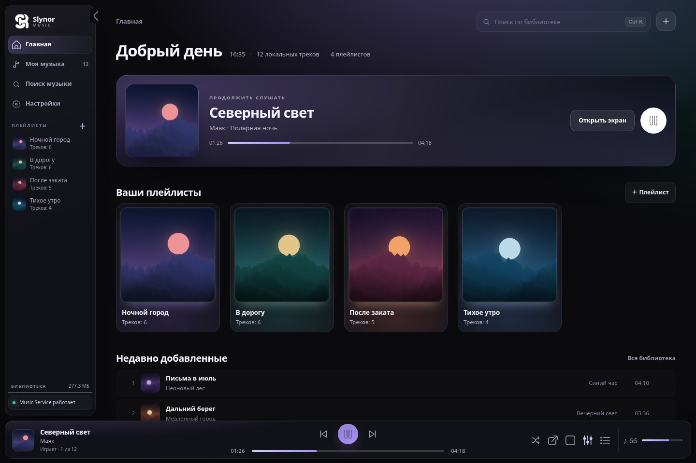
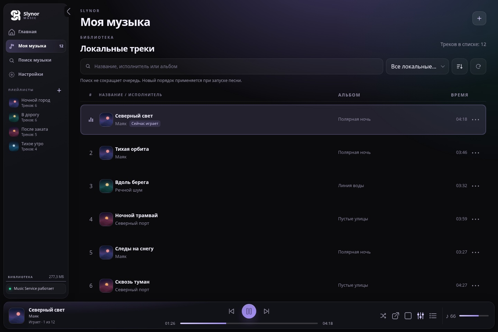
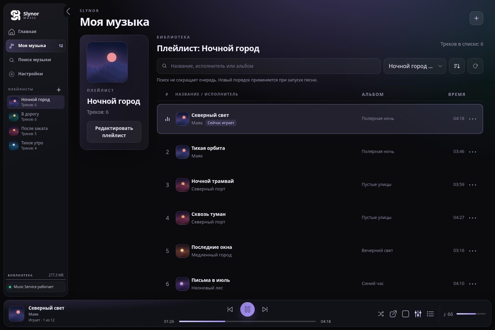
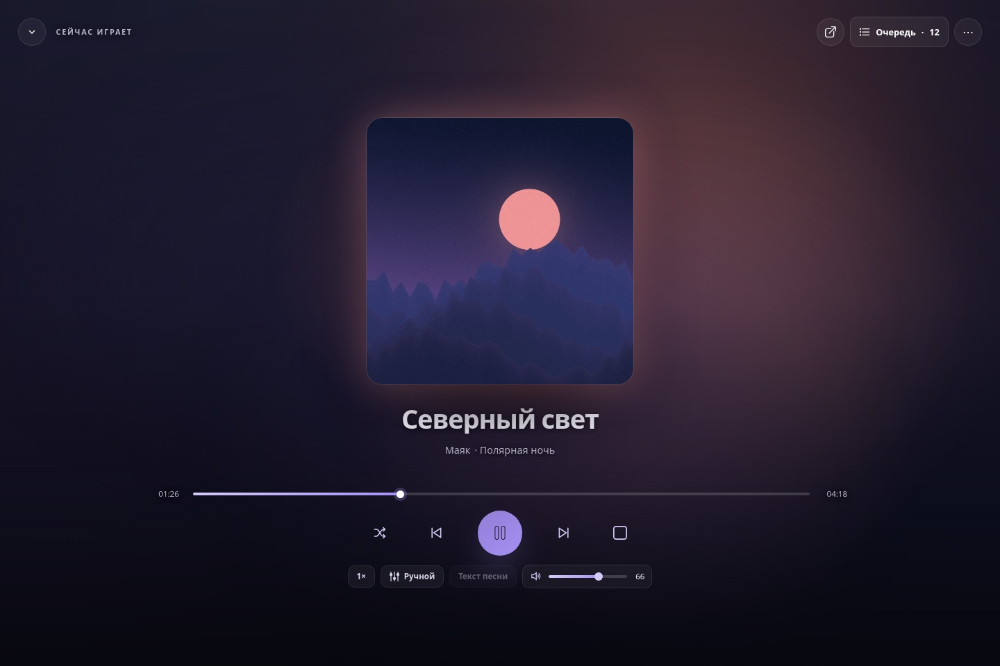
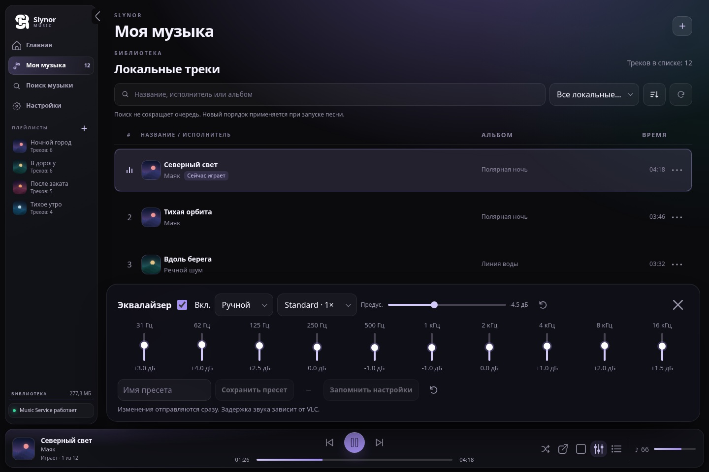
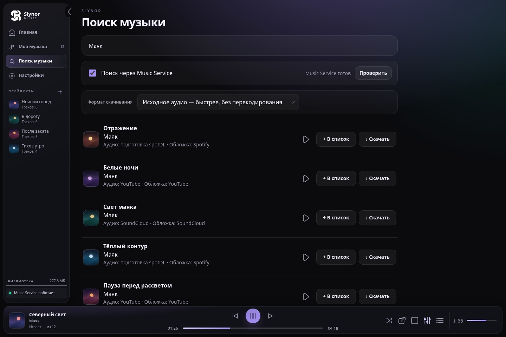
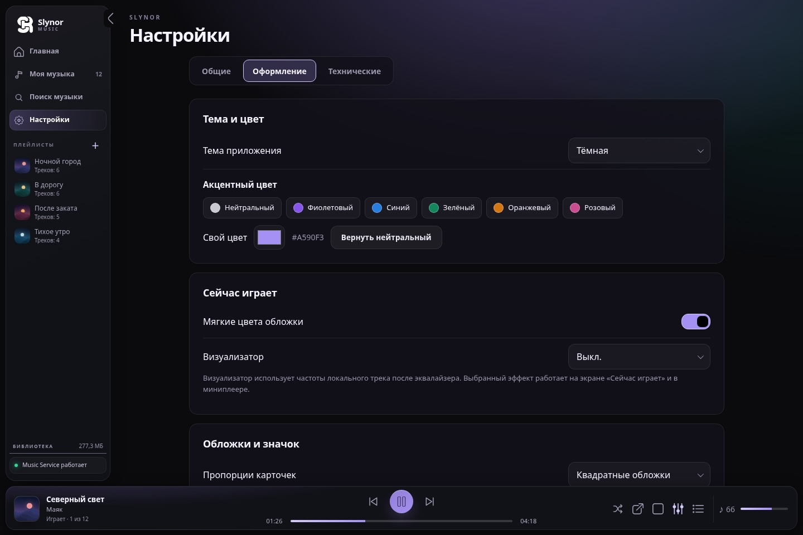

# Slynor

Slynor — музыкальный плеер для Windows 10 и 11. Добавляйте файлы с диска, собирайте плейлисты, ищите музыку в интернете и сохраняйте её в локальную библиотеку.


<p align="center">
  
</p>

## Возможности

- **Библиотека и плейлисты.** Добавление файлов и папок, чтение тегов и обложек, поиск и сортировка. Удаление трека из библиотеки сохраняет исходный файл.
- **Воспроизведение.** Очередь, перемешивание, перемотка, регулировка скорости, мини-плеер и управление из системного трея.
- **Звук.** 10-полосный эквалайзер с предусилением и собственными пресетами. Спектр и фон из обложки на экране «Сейчас играет».
- **Интернет-поиск.** Каталоги YouTube, Spotify и SoundCloud, загрузка доступных файлов и импорт поддерживаемых плейлистов. Результат поиска может содержать только метаданные. Доступность полного аудио определяет источник.
- **Оформление.** Светлая, тёмная и полупрозрачная темы, обои, цвет акцента и формы обложек. Русский и английский интерфейс.
- **Discord Rich Presence.** Название и исполнитель текущего трека в Discord Desktop. Настройка выключена по умолчанию.

<details>
<summary>Библиотека, плеер и настройки</summary>

<p align="center">
  
  
  
  
  
  
</p>

</details>

## Запуск на Windows

Нужны Windows 10 или 11 x64, Python 3.13 x64, VLC 3 x64, FFmpeg с ffprobe и Microsoft Edge WebView2 Runtime. Для установки через PowerShell нужен `winget`.

```powershell
git clone https://github.com/hyoreku/Slynor.git
cd Slynor
.\INSTALL.ps1
.\START.cmd
```

`INSTALL.ps1` устанавливает системные компоненты и создаёт отдельные окружения плеера, провайдеров и поиска. Если системные компоненты уже установлены, используйте `INSTALL.ps1 -SkipSystem`. Для некоторых запросов к YouTube нужен Deno в окружении провайдера.

`START.cmd` запускает плеер в WebView2. Локальному API нужен свободный порт `8765`. Music Service использует порт `8766`. Проверить окружение можно командой `.\CHECK.cmd`.

## Telegram-бот

Бот работает отдельно от окна плеера и использует тот же Music Service. Доступ открывается одному Telegram-аккаунту по числовому ID. Бот принимает название или ссылку на трек, показывает результаты и отправляет выбранное аудио. В настройках доступны оригинальный файл и MP3.

[Настройка и запуск Telegram-бота](docs/TELEGRAM_BOT_RU.md)

## Сборка Windows

Рецепт сборки из исходников создаёт `dist/Slynor-Portable.zip`, `dist/installer/Slynor-Setup.exe` и контрольные суммы SHA-256. Для сборки нужны Python x64, Inno Setup 6, архив встроенного Python и комплект VLC/FFmpeg.

[Инструкция по сборке](docs/BUILD_PORTABLE_STAGE23.md) · [Приёмка на чистой Windows](docs/WINDOWS_ACCEPTANCE.md)

## Данные и устройство проекта

| Путь | Содержимое |
| --- | --- |
| `%LOCALAPPDATA%\OwnPlayerMusic` | Библиотека, плейлисты, настройки, загрузки и обложки |
| `%LOCALAPPDATA%\Slynor\service` | SQLite Music Service, подготовленные аудиофайлы и локальные данные бота |
| `%LOCALAPPDATA%\Slynor\logs` | Журналы и диагностика |
| `frontend/`, `player/` | Интерфейс WebView2 и движок LibVLC |
| `backend/`, `service/`, `telegram_bot/` | API плеера, музыкальные задания и Telegram-клиент |

HTTP-сервисы по умолчанию слушают только `127.0.0.1`. Файлы из сторонних каталогов загружайте, когда у вас есть на это право.

## Разработка

```powershell
.\.venv\Scripts\python.exe -m unittest discover -s tests
.\.venv\Scripts\python.exe start.py --smoke-test
```

[Карта кода](docs/CODE_MAP.md) · [Music Service](docs/SERVICE_STAGE1.md) · [Правила работы с репозиторием](CONTRIBUTING.md) · [План Windows, Android и VPS](docs/ROADMAP_RU.md)

GPL-2.0-or-later. [Текст лицензии](LICENSE) · [Лицензии зависимостей](THIRD_PARTY_NOTICES.md)
